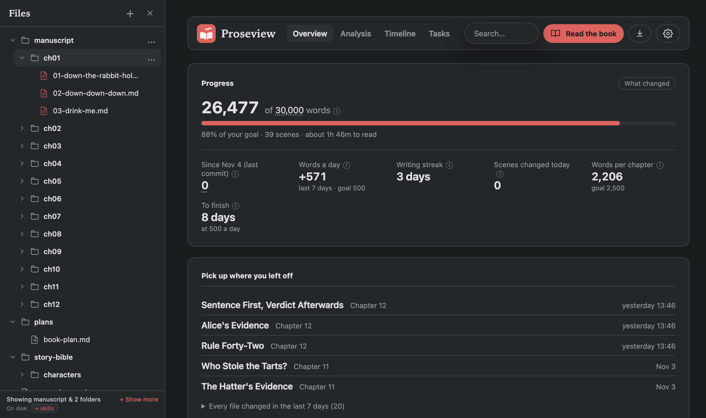
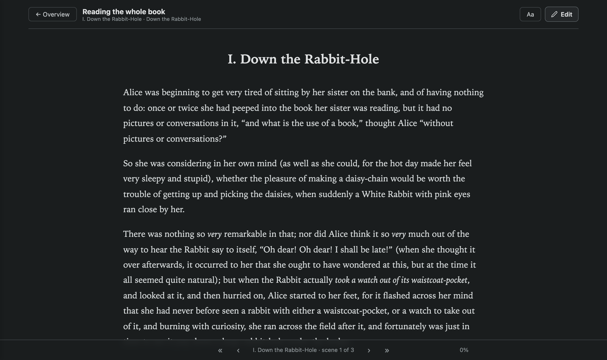
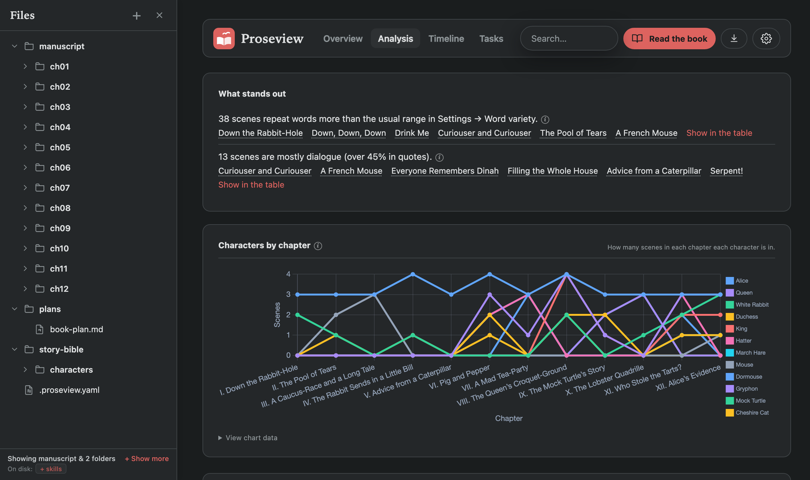
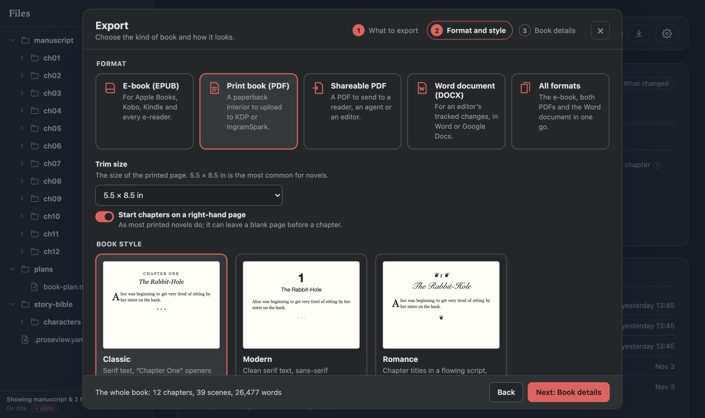
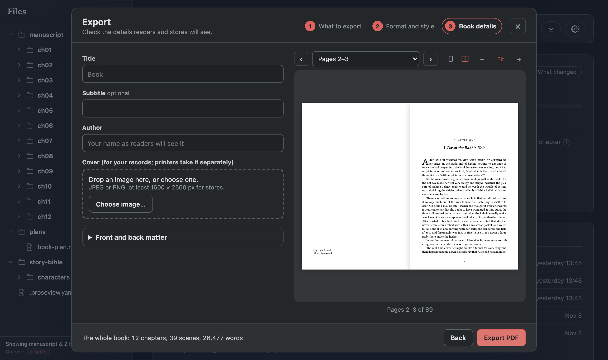

# Proseview

**A writing studio for novels in plain Markdown.**

[](https://github.com/ourarash/proseview/actions/workflows/ci.yml)


[Website](https://ourarash.github.io/proseview/) ·
[Try a sample book](https://ourarash.github.io/proseview/demo/#/scene/ch01%2F01-down-the-rabbit-hole.md) ·
[Start a book in your browser](https://ourarash.github.io/proseview/write/) ·
[Quick start](#quick-start)

Proseview turns a folder of Markdown scenes into a place to write, structure, revise, and publish a book.

You read and edit each scene in clean book typography instead of looking at raw Markdown code (`#`, `**`, YAML). Your files stay plain `.md` on your computer, so you can keep using Obsidian, VS Code, Vim, or Git alongside it. A save changes only what you edited.

Everything runs locally on your machine: no account, no subscription, no database, and no telemetry. AI is optional and off until you ask; without it, Proseview is still a complete writing studio that works offline.

```bash
pipx install proseview
proseview --root /path/to/your/novel
```



**Try it first.** The [sample book](https://ourarash.github.io/proseview/demo/#/scene/ch01%2F01-down-the-rabbit-hole.md)
is the dashboard for *Alice's Adventures in Wonderland*, in your browser: read,
search, open the analysis, edit a scene and export it. [Start a book in your
browser](https://ourarash.github.io/proseview/write/) runs Proseview itself
with nothing to install; the book stays in that browser, and you can download
it as a folder to carry on in the installed app.

## Features

### Write and draft

- **Read like a book, edit in place.** Your prose appears with comfortable
  margins, serif type, and dialogue formatting, with no Markdown symbols in the
  way.
  Press `E` to edit directly on the page with the same typography; press `Mod-S`
  to save and return to reading.
- **Conflict guard.** If you edit a scene in Obsidian, Vim, or any external
  editor while Proseview is open, Proseview prevents overwriting it and shows a
  side-by-side diff of what changed on disk.
- **Drafting aids and callouts.** Highlight any line to reformat it, add a
  callout box (`> [!letter]` for letters or text messages), or drop in an inline
  `<!-- TODO -->` or `<!-- NOTE -->` without leaving your drafting flow.
- **Read the book.** Read the whole manuscript as one continuous text, or turn
  on **Print layout** to read facing pages with running heads and chapter drops
  exactly as Export will print them. It reopens where you stopped.
- **Every Markdown file.** Story bibles, character bios, and worldbuilding
  notes open and edit the same way, with automatic backups. Obsidian wikilinks,
  callouts, and embeds stay as written.
- **Files and search.** Create, rename, and move scenes from the sidebar;
  `Mod-K` searches scene titles, YAML metadata, TODOs, notes, and prose across
  the whole book.
- **Privacy screen.** Press `Mod-J J` (hold `Mod` and tap `J` twice) to instantly
  cover the page with a plain budget spreadsheet; do it again to uncover your
  prose, caret, and scroll exactly where you left them.
  [Optional password →](docs/configuration.md#privacy-screen-password)

### Structure and story

- **Beat Map.** Your agent reads a scene and maps how it moves: its beats on
  an estimated tension curve (from calm to crisis), and its moments by kind:
  dialogue, action, inner thought, or silent reaction. Click a moment to jump
  to its paragraph. It is made only when you ask, and is marked out of date
  when the scene changes.
- **Timeline and storylines.** See the proportion of your chapters, words per
  scene, and storylines as parallel lanes. Compare reading order against story
  chronology so flashbacks and out-of-order scenes are easy to audit.
- **Character presence and pairings.** See which chapters each character
  appears in, and check a co-occurrence chart to see which characters share
  scenes and who never meets.
- **Progress and What changed.** A Progress card tracking words against your
  goal, today's word count, writing pace, and streak. **What changed** shows
  the words written and cut scene by scene, either by period or against a Git
  commit.

### Revise

- **13 Editorial passes.** Built-in checks mark the page with quiet underlines
  and match counts:
  - *Pacing and flow:* sticky sentences (glue words that slow a sentence
    down) and repeated sentence openings.
  - *Repetition:* echoes (a word back within 50 words) and the scene's most
    repeated words.
  - *Clarity and style:* passive voice, filter verbs ("she heard", "he saw"),
    crutch words, hyperbole, figurative language, and sensory details.
  - *Dialogue and POV:* dialogue tags (fancy verbs, adverbs, long runs with no
    tag), all speech tinted, and first-person slips in third-person scenes.
- **Highlight cards.** Click any mark for a short note on what the check
  found. With an agent, **Suggest** offers rewrites in the card, and one click
  applies one.
- **Word variety (MATTR & MTLD).** Tracks vocabulary richness across nearby
  words and whole scenes against typical ranges for your genre (contemporary,
  literary, speculative, or children's). Every metric includes an ⓘ explaining
  how it is measured. [What the numbers mean →](docs/analytics.md)
- **Tasks and notes.** Aggregates every `TODO` and tagged `NOTE` comment across
  all scene files into one place so you don't lose track of revision thoughts.
- **File history.** Step back through earlier versions of a scene, comparing
  changes in a side-by-side or inline diff before restoring.

### Publish

- **Print-ready PDF.** Typesets a paperback interior using Typst across
  standard trim sizes (5 × 8, 5.25 × 8, 5.5 × 8.5, 6 × 9 in, or A5). Includes
  recto chapter starts, running heads, and page numbers.
- **EPUB e-books.** Exports clean, store-ready EPUB3 files with your cover art,
  metadata, and formatted chapters.
- **Word documents (`.docx`).** Exports formatted manuscripts for editors or
  beta readers, including standard submission manuscript format with support for
  tracked changes.
- **Interactive print preview.** Preview the facing pages, trim sizes, and
  typography before exporting. [Export guide →](docs/export.md)
- **A read-only copy to share.** `proseview snapshot` compiles the dashboard
  into a static website you can host anywhere (such as GitHub Pages) for beta
  readers to browse. [Details →](#share-a-read-only-copy)

### Working with an agent (optional)

Proseview has no AI model of its own and needs no API keys. It drives the
Codex or Claude command-line tools already installed and signed in on your
computer, so your agent works under your own account and its own privacy
terms. Proseview itself sends nothing anywhere.

Nothing runs until you ask:

- **The Writers’ Room.** One conversation with two editors (by default, a
  **Story Editor** for plot and pacing and a **Voice Editor** for tone and
  style) who discuss your book with you and with each other. `@mention` one to
  ask just them.
- **Codex and Claude tabs.** One tab per agent in the side panel, each with
  its own conversation. Mention files with `@` or select prose to ask about
  it.
- **Edits you can see.** An edit an agent makes is saved and shown in a card
  with the diff, **Undo all** and **Looks good**.
- **Continuity checks.** Ask whether a passage fits the rest of the book, and
  the answer cites the lines it relies on.

[How the AI features work →](docs/ai.md)

## Everyday shortcuts

| Key | Action |
| :--- | :--- |
| `E` | Edit the scene you are reading |
| `Mod-S` | Save edits and return to reading |
| `Mod-K` | Search scenes, notes, and prose |
| `Mod-J J` | Cover / uncover with the privacy screen |
| `P` | Polish the selected prose with your agent |
| `A` | Ask an agent about the selected passage |
| `X` | Open the Export dialog |
| `F` / `Shift-F` | Distraction-free focus layout / Fullscreen |

## Screenshots

### Editorial passes

Each prose pass shows its match count for the scene; switching one on marks
the page you are reading.


### Editing

`Edit` turns the page you were reading into the page you type into, with the
same typography. `Mod-S` saves the file and returns to reading. A scene's
frontmatter sits above its prose as YAML you can edit, and a typo that is not
valid YAML is pointed out rather than saved.


### Read the book

The whole manuscript as one continuous text, with a quiet bar for progress,
scene and chapter skips and a chapter list. **Print layout** shows the same
book as Export lays it out, page by page, in your chosen style and trim.



### Analysis



### Timeline

Chapter proportions, words per scene, storylines as lanes, and reading order
against the order events happen, so a scene read far from where it happens is
easy to spot.


### Beat Map

Your agent maps a scene's beats on a tension line and lists its moments by
kind. Click a moment and the page shows its paragraph.


### Writers' Room

Ask the room a question and both editors answer in one conversation, each
from their own side of the book.


### Agents

Codex and Claude each keep their own conversation. Opening another file does
not reset either one; the next question simply says which file you are in.


### Search


### Export

Choose the format and style, then see the pages exactly as the file will be.





The screenshots use the bundled demo manuscript, *Alice's Adventures in
Wonderland* (public domain), split into 39 scenes across 12 chapters. See
[fixtures/demo-book](fixtures/demo-book/README.md).

## Quick start

Requires Python 3.11+ on macOS, Linux or Windows.

```bash
pipx install proseview
proseview --root /path/to/your/novel
```

A browser tab opens at `http://localhost:7842`; press Ctrl-C to stop. If you
want to use Claude in the side panel, install the `[claude]` extra instead:
`pipx install "proseview[claude]"`.

Proseview's book features read a `manuscript/` folder with one folder per
chapter and one Markdown file per scene. Frontmatter is optional. Point it at a
folder without a manuscript, such as an Obsidian vault, and it opens as plain
Markdown you can read, edit and search; **Choose manuscript folder…** tells it
where the book is.

```text
my-novel/
├── manuscript/
│   ├── ch01/
│   │   ├── 01-opening.md
│   │   └── 02-meeting.md
│   └── ch02/
│       └── 01-aftermath.md
└── .proseview.yaml          # optional
```

[Layout and frontmatter →](docs/manuscript.md)

### Open it as an app

In Chrome or Edge, click the install icon at the right of the address bar.
The dashboard then opens in its own window with its own Dock or taskbar icon.
It is still the local server underneath, so start `proseview` first; opened
without it, the window says so. The app is tied to `localhost:7842`: it shows
whichever book is served there, and a book that falls back to another port
opens in the browser as before.

### Share a read-only copy

```bash
proseview snapshot --root /path/to/your/novel --out ~/my-novel-site
```

This writes the dashboard as static files any web host can serve, including
GitHub Pages. Readers can browse scenes, search and read the analysis; nothing
on it edits and no server runs, and paths from your computer are replaced by
the folder's name. `--demo` also lets visitors try editing (saved only in their
browser) and download ready-made EPUB, PDF and Word files. `--title`,
`--site-url` and `--preview-image` set how a link to it looks when shared.

## CLI commands

| Command | Description |
| :--- | :--- |
| `proseview serve` | Start the local dashboard server (default) |
| `proseview export` | Compile the manuscript into an EPUB, PDF, or Word document |
| `proseview snapshot` | Write a read-only copy of the dashboard as static files |
| `proseview roster` | Suggest character names found in the manuscript prose |
| `proseview privacy-password` | Set or change the password that uncovers the privacy screen |
| `proseview init` | Write a starter `.proseview.yaml` in the book's folder |

## Configuration

Proseview needs no config file. A `.proseview.yaml` at the root of the book can
change where things live, set word goals, choose which agent tab opens first,
or point the Timeline at your own frontmatter keys; `proseview init` writes a
starter file. Goals, word variety (genre), and color theme can also be changed
in Settings, behind the gear in the header.

```yaml
manuscript_path: manuscript/
target_words: 80000
discuss:
  agent: codex
```

[Every key, with defaults →](docs/configuration.md)

## Documentation

- [Manuscript layout and frontmatter](docs/manuscript.md)
- [Configuration reference](docs/configuration.md)
- [Working with AI](docs/ai.md)
- [What the numbers mean](docs/analytics.md)
- [Exporting: EPUB, PDF and Word](docs/export.md)

## Status

Proseview is alpha: everything described above works today. Still unfinished:

- The `$` skill picker on the Claude tab lists only Codex's skills; Claude
  still uses your Claude skills on its own.
- Read the book does not yet update live when a scene changes on disk.

The full list is in [plans/roadmap.md](plans/roadmap.md).

## Development

```bash
pip install -e ".[dev]"
pytest
```

This runs over a thousand unit tests and an HTTP end-to-end tier that starts a
real `proseview` process and checks what reaches the disk: saves and the
conflict guard, TODOs and notes, the agent bridge and live reload. Agent tests
use a deterministic fake and never contact Codex, Claude or the network.

A browser tier drives the real interface in Chromium:

```bash
pip install -e ".[e2e]"
python -m playwright install chromium
pytest -m e2e_browser
```

Both tiers work on a throwaway copy of `fixtures/demo-repo`. See
[CONTRIBUTING.md](CONTRIBUTING.md).

## License

MIT. See [LICENSE](LICENSE).
