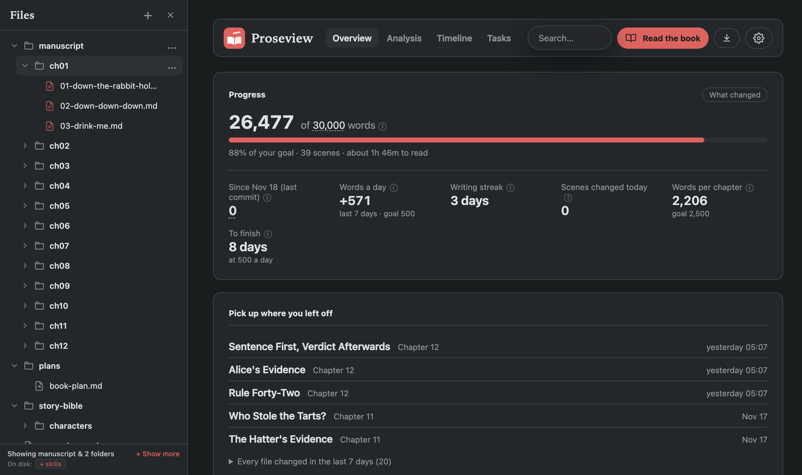
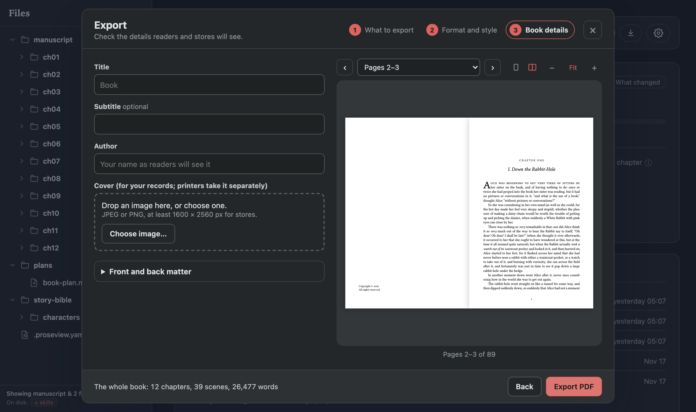
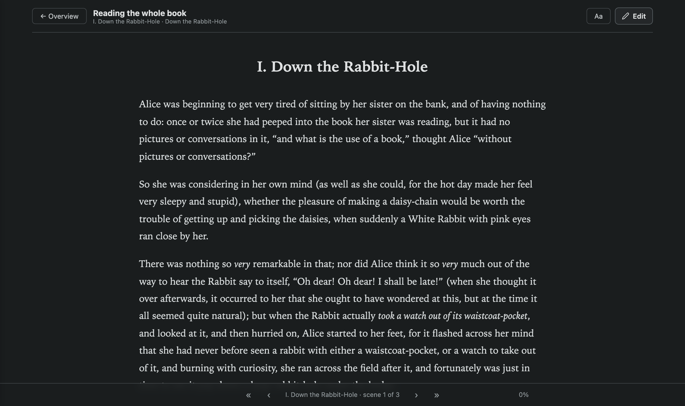
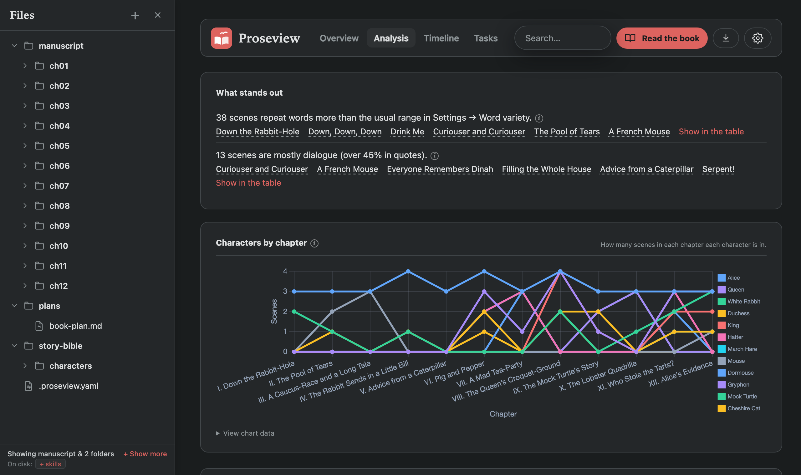
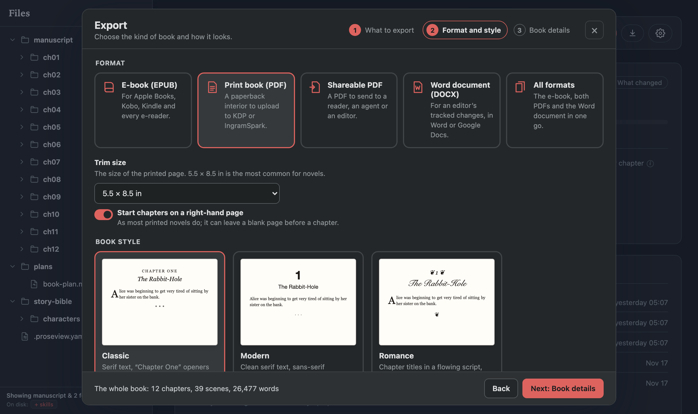

# Proseview

**A writing studio for novels in plain Markdown.**

[](https://github.com/ourarash/proseview/actions/workflows/ci.yml)


[Website](https://ourarash.github.io/proseview/) ·
[Try a sample book](https://ourarash.github.io/proseview/demo/#/scene/ch01%2F01-down-the-rabbit-hole.md) ·
[Start a book in your browser](https://ourarash.github.io/proseview/write/) ·
[Quick start](#quick-start)

Proseview is a local web app that turns a folder of Markdown scenes into a writing studio in your browser. You read, edit, revise, and publish in clean book typography while your files stay plain `.md` on disk—compatible with Obsidian, VS Code, Vim, and Git. Everything runs locally on your machine with no account, database, or telemetry; AI is optional and stays off until you ask.



> **Try it first:** Browse [*Alice's Adventures in Wonderland*](https://ourarash.github.io/proseview/demo/#/scene/ch01%2F01-down-the-rabbit-hole.md) in the live demo, or [start a book in your browser](https://ourarash.github.io/proseview/write/) with nothing to install and download it later.

## Quick start

**macOS or Linux** (Terminal):

```bash
curl -LsSf https://ourarash.github.io/proseview/install.sh | sh
```

**Windows** (PowerShell):

```powershell
irm https://raw.githubusercontent.com/ourarash/proseview/main/site/install.ps1 | iex
```

No Python setup or admin password needed (installs via [uv](https://docs.astral.sh/uv/), asks for your book folder, and adds a **Proseview** launcher). Already use Python 3.11+? Install with `pipx install proseview` (use `pipx install "proseview[claude]"` if you want the optional Claude agent tab). Run the installer again to update.

```bash
proseview                     # Open your last book (or the book in the current folder)
proseview open                # Pick another book folder
proseview new                 # Start a new book with its first scene
```

Full novel features (chapters, progress, timeline, export) read from `manuscript/` with one folder per chapter and one `.md` file per scene—frontmatter and `.proseview.yaml` are optional. You can also point Proseview at any Markdown folder (such as an Obsidian vault) to read, edit, and search right away. [Layout and frontmatter →](docs/manuscript.md)

## Features

### Write & organize
- **Read like a book, edit in place:** Press `E` to edit directly in the same typography and `Cmd/Ctrl+S` to save, with a side-by-side conflict guard if the file changed in another editor.
- **Continuous reading & Print layout:** Read the whole manuscript as one continuous book (live-reloading as files change on disk), or preview facing typeset pages with running heads and chapter drops.
- **Story bible, YAML & notes:** Edit character bios, plans, and `.yaml` configs (including `.proseview.yaml`) in place with syntax highlighting, callout boxes (`> [!letter]`), inline `<!-- TODO -->` / `<!-- NOTE -->` markers, and automatic backups.
- **Scene labels & colors:** Tag scenes in frontmatter (`label:`) or from the reading view, customize colors in **Settings → Appearance**, and see them across Overview, Sidebar, continuous reading, and Timeline.
- **Instant search:** `Cmd/Ctrl+K` searches titles, metadata, notes, and prose across your whole project.
- **Privacy screen:** `Cmd/Ctrl+J J` covers the window with a decoy spreadsheet, manually or after an idle timeout ([optional password →](docs/configuration.md#privacy-screen-password)).


### Structure & revise
- **13 local prose checks (no AI):** Quiet inline underlines for sticky sentences, echoes, repeated words and openings, passive voice, filter verbs, crutch words, dialogue tags, POV slips, and more.
- **Vocabulary richness (MATTR & MTLD):** Tracks lexical variety against genre ranges ([what the numbers mean →](docs/analytics.md)).
- **Timeline, storylines & characters:** Compare chapter proportions, parallel storyline lanes, reading order vs. story chronology, and character co-occurrence across chapters.
- **Progress & revision history:** Track word-count goals, daily pace, streaks, running word totals per scene, word deltas by period or Git commit, and diff/restore automatic file backups.


### Working with an agent (optional)
Proseview has no model of its own and needs no API keys—it connects to the local Codex, Claude, or Antigravity (Gemini) CLI already signed in on your machine, using your existing subscription. Nothing runs until you ask. [How AI features work →](docs/ai.md)

- **The Group:** Two or three AI agents (Codex, Claude, or Antigravity) debate the same scene—each focused on story, voice, or continuity—respond to each other, and summarize agreements and suggested edits.
- **Scene reviews & Beat Map:** Run **Quick critique**, **Deepen & layer** (subtext and sensory detail), **Craft review** (McKee, Coyne, Cron, Snyder, King, Lamott), **Comedy review**, or map scene beats along a tension curve.
- **Compare & reversible edits:** Preview suggestions side by side against your prose, apply selected findings or pick among rewrites, and review every agent edit with **Undo all** / **Looks good**.
- **Scene illustrations:** Ask Codex, Antigravity, or Claude for an illustration of a scene in one of six styles; insert the one you like and it saves beside the chapter as a standard Markdown image link.
- **Transparent context & token use:** Choose what each conversation sends with your questions (beat map, full scene, story notes, neighboring scenes) and inspect the tokens each reply used.


### Publish
- **Print-ready PDF, EPUB3 & Word (`.docx`):** Typeset paperbacks via Typst (bundled—no Pandoc, LaTeX, or Calibre to install) in trim sizes from 5×8 to 6×9 in or A5 with interactive facing-page preview, store-ready EPUB3, and submission-ready `.docx` ([export guide →](docs/export.md)).
- **Read-only web snapshots:** `proseview snapshot` compiles your dashboard into static HTML for beta readers or GitHub Pages.



### On your phone
Run `proseview --remote` to keep writing from your phone while Proseview runs on your computer: read the book and scenes, tap a paragraph to add a TODO or note, make quick plain-text edits (voice dictation works), and ask Codex, Claude, or Antigravity about the scene. Drafts stay safe on your phone until you save, with conflict protection so edits made on your computer are never silently overwritten.

1. Install [Tailscale](https://tailscale.com/download) on both devices with the same account, and enable **HTTPS Certificates** under DNS in the Tailscale admin console.
2. Run `proseview --remote`. Proseview prints a private `https://….ts.net` address and shows a scannable QR code in **Settings**.

Access is limited to your private Tailscale network—no extra accounts, passwords, or pairing. Your computer stays awake while remote mode is running (lid open). To revoke a lost phone, remove it in the Tailscale admin console.


<details>
<summary>More screenshots (Read the book, Analysis, Timeline, Beat Map, Reviews, Agents, Search, Export)</summary>

**Read the book**



**Analysis**



**Timeline**


**Beat Map**


**Scene reviews**


**Agents**


**Search**


**Export formats**



*Screenshots use the bundled public-domain demo book ([fixtures/demo-book](fixtures/demo-book/README.md)).*

</details>

<details>
<summary>Shortcuts, CLI commands, desktop app & snapshots</summary>

### Everyday shortcuts

| Key | Action |
| :--- | :--- |
| `E` | Edit the open scene or file |
| `Cmd/Ctrl+S` | Save edits and return to reading |
| `Cmd/Ctrl+K` | Search scenes, notes, and prose |
| `Cmd/Ctrl+J J` | Cover / uncover with the privacy screen |
| `P` / `A` | Polish / ask an agent about selected prose |
| `X` | Open Export |
| `F` / `Shift+F` | Focus layout / Fullscreen |

### CLI commands

| Command | Description |
| :--- | :--- |
| `proseview serve` | Start the local server (default) and open your last book |
| `proseview open` | Choose a book folder (or pass one) and open it |
| `proseview new` | Start a new book with its first scene |
| `proseview export` | Export EPUB, print/share PDF, or `.docx` |
| `proseview snapshot` | Build a read-only static site (`--demo` enables browser-only edits) |
| `proseview roster` | Suggest character names found in the manuscript |
| `proseview privacy-password` | Set or change the privacy screen password |
| `proseview init` | Create a starter `.proseview.yaml` |
| `proseview --remote` | Also open Proseview on your phone over Tailscale |

### Open as a desktop app
In Chrome or Edge, click the install icon in the address bar to open `http://localhost:7842` in its own Dock/taskbar window (start `proseview` first).

</details>

## Documentation

- [Manuscript layout and frontmatter](docs/manuscript.md)
- [Configuration reference (`.proseview.yaml`)](docs/configuration.md)
- [Working with AI](docs/ai.md)
- [What the numbers mean](docs/analytics.md)
- [Exporting: EPUB, PDF and Word](docs/export.md)

## Status & Development

Proseview is alpha (see [plans/roadmap.md](plans/roadmap.md)). Known gap: the `$` skill picker on the Claude tab lists only Codex's skills.

```bash
pip install -e ".[dev]"
pytest

# Browser E2E tier
pip install -e ".[e2e]"
python -m playwright install chromium
pytest -m e2e_browser
```

See [CONTRIBUTING.md](CONTRIBUTING.md). Licensed under [MIT](LICENSE).
